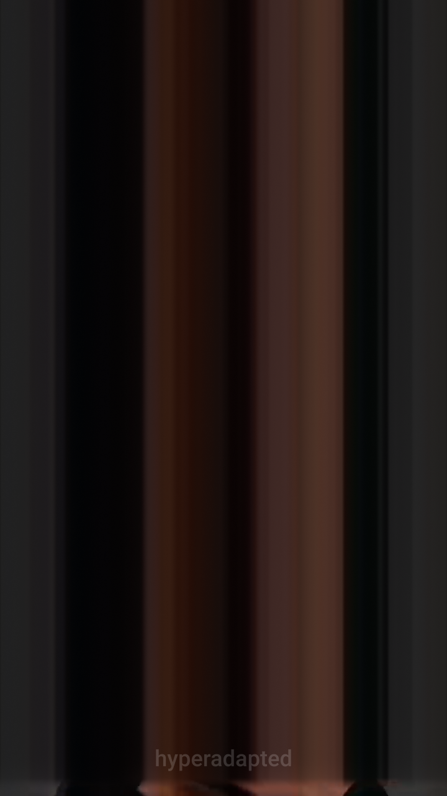

# Async spectral

A vertical Short, cut out of sync with itself: a line sweeps through the picture and holds what it crosses as streaks, and the streaks are played back as sound.

Open `async-spectral.toe` in TouchDesigner 2025.

## How it works

The chain runs left to right in `/project1`:

- `source_deck` (shared module) plays the video and its sound: a YouTube Short, downloaded on demand into `media/youtube/`.
- `async_cut` sweeps a cut line across the picture over the length of the video (zigzagging back at the end, eased). Behind the cut, the pixels at the cut are held and drawn out into streaks toward one side, up by default. A feedback loop makes the streaks lag behind in time, more the further they are from the cut, so the far side settles while the cut stays crisp.
- `spectral_voice` hears the streaks. A shader cuts the picture into 64 strips, walks each one along the beam direction and keeps what stays the same from sample to sample, the beams; each strip is a place on the frequency axis between Lowest and Highest. Red, green and blue drive three partials an octave band apart (red low, blue high), loud where the colour is bright and the strip has turned into beam. The partial bank goes through a ping-pong echo and an eight-line feedback-delay-network reverb, written in numpy in a Script CHOP. The original sound plays for the first and last few seconds of the video (Fade In, Fade Out) and crossfades into the beam voice in between.
- `output_deck` (shared module) frames the result for a phone at 9:16 over a blurred copy of itself, adds the watermark, sends it to OBS over Spout/Syphon if asked and records it with its sound to `media/exports/`.

Each project COMP keeps its controls on its own pages: Cut and Smear on `async_cut`, Voice and Space on `spectral_voice`.

## Using another video

On `source_deck`'s Sources page, paste a link into YouTube Video Link and YouTube Audio Link and press the two Download pulses. yt-dlp runs from the project's `.venv`, as declared in `.embody/project.json` (`op.Embody.InstallPackages(['yt-dlp', 'yt-dlp-ejs'])` installs it on a new machine). The sweep and the fades follow the new video's length by themselves; for a recording of the whole video, set `output_deck`'s Stop After on its Record page to that length.

Neither `media/youtube/` nor `media/exports/` is in git.

## The shared modules

`source_deck` and `output_deck` are copies of the modules in `../00-custom-modules/`, saved inside the `.toe`: Enable External .tox is off, so this project keeps the module versions it was made with. Their External .tox Path points at `../00-custom-modules/`, so Save Module on either one writes back to the shared module.
