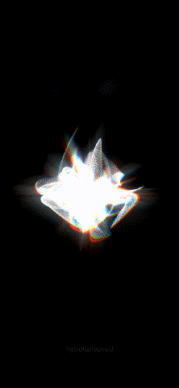

# Color ribbon butterfly

250,000 instanced hexagons placed by animated 4D simplex noise, smeared into colored ribbons by feedback, RGBA delay and a radial blur.

Open `color-ribbon-butterfly.toe` in TouchDesigner 2025. The preview was recorded with the shared `output_deck` module.
