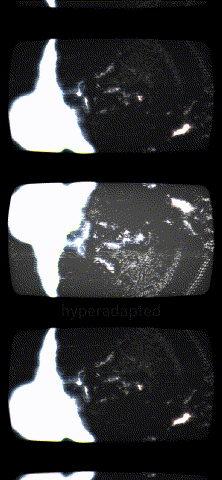

# Ferroscope

Sound as ferrofluid: a spike lattice raised by a kaleidoscope-folded sonogram, leaning toward the viewer on camera, through the shared CRT filter. Its Output page frames, shares and records the picture.

Open `ferroscope.toe` in TouchDesigner 2025. The preview was recorded with the shared `output_deck` module.
