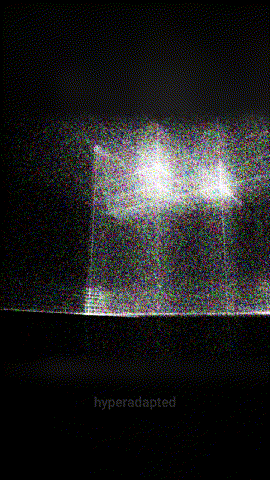

# Infinite hypercube

262,144 points carried by a self-displacing noise field inside a cube whose faces wrap around, with trails, depth blur and RGBA delay.

Open `infinite-hypercube.toe` in TouchDesigner 2025. The preview was recorded with the shared `output_deck` module.
