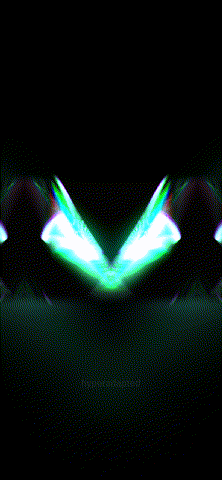

# Iridiscent viz

A music visualizer: a turbulent particle stream lit by an audio track (kick to bloom, rhythm to glow, highs to color and rotation), with feedback, mirroring and tiling.

Open `iridiscent-viz.toe` in TouchDesigner 2025. The preview was recorded with the shared `output_deck` module.
