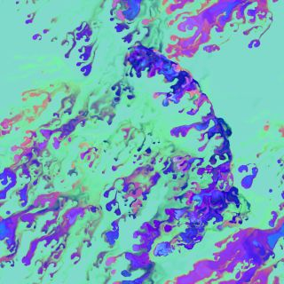

# Liquid paint

Painting with the mouse into a single-pass fluid: every stroke smears into dripping, marbled trails, advected by a Shadertoy CFD shader in a GLSL TOP feedback loop and recoloured through a Noise TOP.



Open `liquid-paint.toe` in TouchDesigner 2025.

Built along Jack DiLaura's [Generative Liquid Paintings in TouchDesigner](https://www.youtube.com/watch?v=OfHx9OTx5p4) (The Interactive & Immersive HQ, TouchDesigner Tutorial 144). The fluid is Buffer A of flockaroo's [single pass CFD](https://www.shadertoy.com/view/MdKXRy) (Shadertoy, 2016), ported to TouchDesigner. The network is the COMP `/project1/liquid_paint`, built in TouchDesigner 2025.32820.

## Painting

`opviewer1` is the canvas: open its viewer (right-click it, View...) or point a Panel pane at it. Hold the left mouse button and drag to paint; right-click to clear. After a long session the colours mix into one even tint, so clear and start again.

## How it works

| Group | Operators | What it does |
|---|---|---|
| Brush | `noise_paint` → `circle_brush` → `null_brush` | Colour noise (period 0.25, 1024×1024, 16-bit float) seen through a soft circle (radius 0.05, softness 0.025, Multiply). The circle follows the mouse, and its fill alpha is the left button, so it paints only while held. |
| Liquid simulation | `feedback_canvas`, `composite_brush`, `noise_flow`, `glsl_liquid` | The brush is composited over the previous frame, and the shader advects the result. Its second input is animated static noise (period 0, Translate Z `absTime.frame`) for the stochastic sampling, its third the reset image. Input Extend Mode UV is Repeat, so the edges wrap without artefacts. |
| Recolor and output | `noise_recolor` → `null_out` → `out1`, `opviewer1` | The simulation feeds both inputs of a Noise TOP. The second input's RGBA becomes each pixel's noise coordinate, so the paint is remapped through the noise field. `opviewer1` shows `null_out` at its own size. |
| Mouse input | `panel_mouse` → `select_buttons` / `select_uv` → `math_uv` → `merge_mouse` → `null_mouse` | A Panel CHOP on `opviewer1` reads `lselect rselect u v`; `u` and `v` are remapped from 0..1 to -0.5..0.5 for the circle centre. |

The paint's red and green channels are also its velocity field. For each pixel the shader measures how the colour rotates around it on circles of doubling radius and moves the pixel along that rotation: the colour is the flow.

## Knobs

| Parameter | Effect |
|---|---|
| `noise_recolor` Seed | The palette. 5 gives violet and indigo paint with a magenta accent on mint; every seed is a different scheme. |
| `noise_recolor` Period | How smooth the colour is (15 here). Lower values make freshly painted areas grainy. |
| `noise_flow` Period, Translate Z | How the paint moves. Period 0 is TV static; about 5, with the `absTime.frame` animation removed, gives a calmer, more directional flow. |
| `circle_brush` Radius, Softness | Brush size and edge. |
| `noise_paint` Seed, Period | The colours the brush lays down. |

## Changes from the tutorial

- The shader is ported from the Shadertoy original, not copied from the code in the video description. It makes the changes the video describes: TouchDesigner's input samplers and resolutions, a right-mouse reset uniform `uRMB` instead of `iFrame` and the I key, and no centre "motor", so only the brush drives the flow.
- The brush is the composite's first input, over the canvas, and the shader writes an opaque canvas. With the feedback on top, paint that has built up would hide new strokes.
- A `uFrame` uniform (`absTime.frame`) keeps the sampling angle changing every frame, even when `noise_flow` is no longer animated.
- The network sits in its own COMP and ends in an Out TOP `out1`.

## Performance

`glsl_liquid` costs about 1.4 ms of GPU time per frame at 1024×1024, and memory stays flat while it runs.

## The shader

`glsl_liquid_pixel`, the pixel shader of `glsl_liquid`. Vectors page: `uRMB` = `op('null_mouse')['rselect']`, `uFrame` = `absTime.frame`.

```glsl
// Liquid paint: single-pass rotational self-advection ("computational flockarooid dynamics").
// Ported to TouchDesigner from Buffer A of "single pass CFD" by Florian Berger (flockaroo),
// Shadertoy 2016, CC BY-NC-SA 3.0, https://www.shadertoy.com/view/MdKXRy
// Changes from the original: TD samplers and resolutions, right mouse resets instead of
// iFrame / the I key, the centre "motor" is removed so only the brush drives the flow.
//
// Inputs: 0 = canvas (feedback with the brush composited on top)
//         1 = per-pixel noise (stochastic sampling angle)
//         2 = reset image
// The canvas RG channels double as the velocity field: the paint colour IS the flow.

#define RotNum 5   // rotation samples per scale; the fast path below needs it odd

#define Res  (uTD2DInfos[0].res.zw)
#define Res1 (uTD2DInfos[1].res.zw)

uniform float uRMB;    // right mouse button: > 0.5 resets the canvas to input 2
uniform float uFrame;  // frame counter: walks the noise lookup that picks this frame's angle

layout(location = 0) out vec4 fragColor;

const float ang = 2.0 * 3.1415926535 / float(RotNum);
const mat2 m = mat2(cos(ang), sin(ang), -sin(ang), cos(ang));

vec4 randS(vec2 uv)
{
    return texture(sTD2DInputs[1], uv * Res / Res1) - vec4(0.5);
}

// Mean rotation of the field around pos, sampled at RotNum points on a circle of radius |b|.
float getRot(vec2 pos, vec2 b)
{
    vec2 p = b;
    float rot = 0.0;
    for (int i = 0; i < RotNum; i++)
    {
        rot += dot(texture(sTD2DInputs[0], fract((pos + p) / Res)).xy - vec2(0.5), p.yx * vec2(1.0, -1.0));
        p = m * p;
    }
    return rot / float(RotNum) / dot(b, b);
}

void main()
{
    vec2 pos = gl_FragCoord.xy;
    float rnd = randS(vec2(uFrame / Res.x, 0.5 / Res1.y)).x;

    vec2 b = vec2(cos(ang * rnd), sin(ang * rnd));
    vec2 v = vec2(0.0);
    float bbMax = 0.7 * Res.y;
    bbMax *= bbMax;
    for (int l = 0; l < 20; l++)   // one octave of scale per pass: b doubles until it spans the canvas
    {
        if (dot(b, b) > bbMax) break;
        vec2 p = b;
        for (int i = 0; i < RotNum; i++)
        {
            v += p.yx * getRot(pos + p, b);
            p = m * p;
        }
        b *= 2.0;
    }

    vec4 c = texture(sTD2DInputs[0], fract((pos + v * vec2(-1.0, 1.0) * 2.0) / Res));
    if (uRMB > 0.5) c = texture(sTD2DInputs[2], vUV.st);
    // Opaque canvas: the brush composites over it (composite input 0) instead of under it.
    fragColor = TDOutputSwizzle(vec4(c.rgb, 1.0));
}
```

## Credits and license

- Fluid shader: Florian Berger (flockaroo), [single pass CFD](https://www.shadertoy.com/view/MdKXRy), Shadertoy 2016, CC BY-NC-SA 3.0. The port above is shared under the same license: attribution, non-commercial, share-alike.
- Network: after Jack DiLaura's tutorial for The Interactive & Immersive HQ, which credits the recolouring through a Noise TOP's second input to Paketa12 and others.
