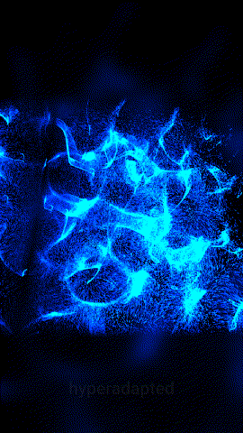

# Noise attractor landscape

A GPU particle swarm in turbulence, wind and force fields, with three presets of each spread across the swarm.

Open `noise-attractor-landscape.toe` in TouchDesigner 2025. The preview was recorded with the shared `output_deck` module.
