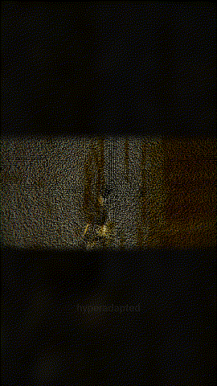

# Touch the sonogram

An installation: the same wavetable drone as `time-series-wavetable`, shaped by a camera and a microphone and drawn as a point-cloud sonogram.

Open `touch-the-sonogram.toe` in TouchDesigner 2025. The preview was recorded with the shared `output_deck` module.
